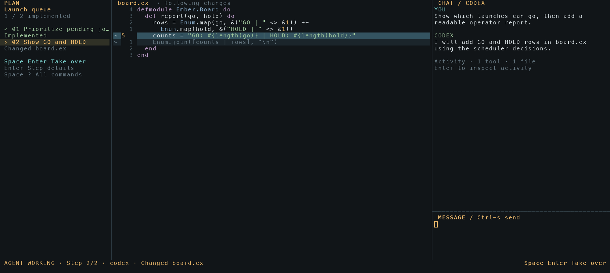

# Kiln

**One chat. A clear plan. Visible implementation.**

Kiln is a terminal programming workspace built around one continuous conversation with Codex or Claude. Start by discussing what you want to build. The agent inspects the repository in planning mode, asks questions, and works with you toward a justified dossier with specific steps.

When a coherent dossier is ready, its steps appear on the left. Run the plan once, and Kiln implements those steps in order in the same conversation and checkout. The active step stays highlighted while code changes appear in the middle and explanations continue in the chat on the right. Interrupt, change the plan, or handcode at any time, then resume.

```sh
kiln /path/to/your/project
```

To open a particular file:

```sh
kiln /path/to/your/project lib/app.ex
```

The local setup provides `kiln` on your PATH. From another checkout, use `./bin/kiln` directly or add its `bin` directory to your PATH. `--help` lists the arguments. Kiln uses the CLIs already installed on your machine and preserves your regular Neovim configuration and provider accounts.



*Offline interface fixture; no model activity is claimed by this screenshot.*

## Plan and implement in one conversation

1. Type the desired change in the chat prompt and press `Ctrl s`. Continue discussing requirements and tradeoffs in that same chat. Planning uses the provider's read-only or plan mode; it does not start implementation.
2. A valid dossier proposal automatically appears as a numbered outline on the left. Keep discussing it or press `Space L` to edit its Markdown directly. Every step has an observable outcome, a concrete reason, and verification criteria. Small changes can have one step.
3. Press `Space Enter` to **Start**. Kiln sends one step at a time to the same native provider conversation. The agent explains meaningful edits and performs the specified checks. After successful turn completion and an explicit report that the step is complete, Kiln advances to the next step automatically.
4. Send a new chat message to interrupt with further direction, use `/pause` or `Space x` to stop, or press `Space h` to take control of the code. Editing the code or dossier also pauses the sequence. Save your changes, then send a follow-up or `/resume`. The next agent turn receives the saved-file handoff and resumes live following.
5. When all steps are implemented, Kiln stops at `READY FOR REVIEW`. Press `Space Enter` to review files and observed check results grouped by dossier step. Enter opens a file diff or the full check output; `Space v` in the review list explicitly marks the selected file's current snapshot reviewed. Later edits invalidate that review. Implementation status is an agent report, not human approval, and the default workflow does not commit, merge, push, or deploy anything.

The default flow uses the current checkout throughout. It does not create a separate chat or worktree for every step, and it does not require review-and-integration clicks between ordinary steps. Optional isolated tasks remain available for work that benefits from them.

## Workspace

Before a dossier exists, the workspace shows code and the planning chat. Once the plan is ready, the left outline joins them:

```text
┌─────────────────────┬───────────────────────────────┬──────────────────────────┐
│ PLAN                │ board.ex · following changes  │ CHAT / CODEX             │
│                     │                               │                          │
│ ✓01 Prioritize jobs │            NEOVIM             │ Same conversation:       │
│    6 tests passed   │                               │ planning, explanations,  │
│ →02 Show the queue  │  Newest change emphasized     │ questions, and results   │
│    Editing board.ex │                               │ Activity · Enter inspect │
│ ○03 Export report   │                               ├──────────────────────────┤
│    Waiting          │                               │ Your next message        │
└─────────────────────┴───────────────────────────────┴──────────────────────────┘
 AGENT WORKING · Step 2/3 · Codex editing board.ex       Space Enter Take over
```

One persistent status strip reports the actual current action and control ownership. The contextual `Space Enter` action becomes Start, Take over, Resume, or Review. During cancellation it reports STOPPING until the provider process exits; only then does it show YOU HAVE CONTROL. Saving a manual edit shows which files will be reread on resume.

All panes are Neovim buffers. Use Vim motions, `/` search, visual selection, and yank commands in the chat and outline as well as the code. `Enter` in the outline opens a step's full rationale and verification without changing which step is executing. All steps remain available in the scrollable outline. The checklist shows observed file activity and actual command results; assistant claims alone never create passing test totals.

The chat keeps your conversation and the agent's explanations visible. Accepted dossier proposals fold into a short summary. Consecutive tool calls, file events, and provider diagnostics collapse into inspectable activity entries. `Enter` opens their complete original output; failures remain prominent. A file link under an explanation connects it to the following edit; `gf` opens that changed file. Check output becomes stale after relevant source edits and remains inspectable until an actual rerun replaces it.

Live file events display actual source with inline Git changes. The latest observed edit receives stronger highlighting; older changes stay quieter. `]c` and `[c` navigate change locations, including deletion anchors. Inspecting or navigating code pins the view while the agent continues; `Space f` restores following. Removed files open a diff so their former content remains inspectable. `Space d` opens review grouped by step. Keyboard focus stays where you left it, and unsaved code is preserved during external updates.

## Interrupt and revise

A new message submitted during implementation stops the current turn before the follow-up runs. `/pause` stops without submitting another instruction. `Space h` requests the writer to stop before handing focus to the code. Saved manual changes are tracked by file and sent to the next turn in the same conversation; unsuccessful turns leave that handoff pending.

Use `/plan` to return to a planning discussion, or `Space L` to edit the dossier. Saving an edited step invalidates that step's recorded completion and later outcomes. Earlier unchanged steps remain complete; changes to the shared brief invalidate the sequence from its beginning. Previous runtime records are retained as history. Resuming starts with the first unfinished step rather than silently treating revised instructions as already implemented.

A proposed dossier never overwrites an unsaved dossier buffer. If a planning response is deferred because local edits are unsaved, save those edits and use `Space A` to adopt the held proposal. Kiln does not run an older dossier while a newer proposal is waiting. Reopening Kiln restores the chat and plan with automatic execution paused.

The dossier is plain Markdown:

```markdown
# Priority queue
Goal: Prioritize queued jobs without losing work.
Approach: Extend the existing queue API and tests.
Why this approach: Preserve callers and use the current queue implementation.

## Step queue: Stable priority ordering
Outcome: Return jobs by priority with predictable ties.
Why: Callers need a deterministic capacity boundary.
Verify: Run the existing suite plus priority and tie-order tests.
Depends: none
```

Each step requires `Outcome`, `Why`, and `Verify`. A `Depends` field naming another step also needs a `Dependency reason`; in the sequential workflow, the prerequisite must appear earlier in the document. The parser checks structure and dependency validity. You and the agent still judge whether the proposed steps and their reasons are useful.

## Keys and chat commands

The leader key is **Space**.

| Key or command | Action |
| --- | --- |
| `Space Enter` | Contextual Start, Take over, Resume, or Review |
| `Ctrl s` | Send the prompt in normal or insert mode |
| `/run`, `/resume`, `Space N` | Run or resume the dossier in order |
| `/pause`, `Space x` | Interrupt the sequence |
| `/plan`, `Space P` | Return to planning in the same conversation |
| `Space l` | Focus the left dossier outline |
| `Space L` | Pause and edit the dossier; `:w` validates it |
| `Space A` | Adopt a held planning proposal after saving local edits |
| `Enter` in the outline | Inspect a step without moving execution |
| `Space h` | Pause the writer and take control of the code |
| `Space a`, `Space e` | Focus the chat prompt or code |
| `Space p`, `Space m` | Change provider or model |
| `Space d`, `Space D` | Review files and checks by step, or close the diff |
| `]c`, `[c` | Next or previous change; pin the code view |
| `Space v` in review | Mark the selected file snapshot reviewed |
| `Space f` | Toggle live file following |
| `Space b` | Browse files |
| `Space c` in visual mode | Add the selected code to the prompt |
| `Space r` in the chat | Reuse the current event in the prompt |
| `Space t` | Open the native provider interface for approvals |
| `Space Space`, `Space ?` | Open the command palette or help |
| `Ctrl h/j/k/l` | Move between panes |

Use `Esc` to leave insert mode, `:w` to save, and `:qa` to exit. Direct commands include `:KilnPlan`, `:KilnRun`, `:KilnPause`, `:KilnDossier`, and `:KilnDossierEdit`. The launcher temporarily disables terminal flow control so `Ctrl s` reaches Neovim, then restores the terminal when Kiln exits.

## Providers and models

Codex and Claude keep their own authentication, configuration, and native session history. The default model is the selected CLI's configured default; choose a model supported by your account to override it.

A provider change pauses implementation and keeps the same visible chat. Kiln stores each provider's native conversation separately and supplies a conversation handoff to the selected provider. Switching back resumes that provider's own saved native ID; IDs are never copied between providers. Model overrides apply to the next turn. Use `/resume` when ready to continue after a provider change.

Kiln normally reuses the accounts already signed in to the installed CLIs. A separate login is not required. Inspect the selected accounts with:

```sh
kiln --accounts
```

To require a particular personal account while keeping those existing sessions, configure `$KILN_STATE_DIR/providers.json`, or `.state/providers.json` when the state directory is not overridden:

```json
{
  "expected_email": "you@example.com"
}
```

When `expected_email` is set, streamed and native agent sessions require that account. A missing or different account is reported before the agent starts. Without a local profile, Kiln uses the normal CLI configuration.

If you deliberately want separate logins, add optional `claude_config_dir` and `codex_home` fields with absolute profile-directory paths. These select isolated CLI profiles without changing the defaults or copying credentials. Omit those fields to reuse the normal CLI logins.

Only when the selected profile needs a login, run `kiln --login claude` or `kiln --login codex`.

`--login` runs only when explicitly requested. Claude's subscription login receives the expected email when configured. Codex uses device authorization; open its displayed link in the browser profile you intend to use. The selected account is checked again after login.

The bridge asks agents to explain the work they are doing, identify changed files, and report validation. Codex emits structured activity events; Claude additionally supports incremental text. Visibility is limited to the events and filesystem writes a provider exposes. Kiln does not display private internal reasoning or claim to observe hidden provider work.

Planning uses Codex’s read-only sandbox or Claude’s plan mode. Implementation uses Codex’s workspace sandbox or Claude’s normal edit permission mode. Kiln does not enable unrestricted permission bypasses. Actions that cannot be approved in a streamed run are reported as blocked; they do not receive silent blanket approval. Once a session exists, `Space t` opens its native provider interface to handle approvals and continue work. Press `Ctrl ]` to enter terminal normal mode, then `q` to close it. The next streamed turn resumes the same provider history; output from the native interface is not copied into the Kiln transcript.

## Optional isolated tasks

`Space n` creates an independent task in a Git worktree from committed HEAD; dirty main-checkout files are not copied. `Space s` switches sessions, and `Space g` shows the optional task overview. Different worktrees can run concurrently, with one editing owner per worktree. `Space R` adds a plan-mode reviewer to the selected task.

These advanced task controls retain explicit review and integration. `Space v` records the current idle task snapshot as reviewed. `Space i` integrates only that exact reviewed snapshot into a clean, idle main checkout after conflict preflight. Later edits invalidate review. Task branches and worktrees remain available for inspection; integration is local and never pushes or deploys.

The earlier dossier dispatcher remains available in those task sessions. Its per-step provider/model assignments, immutable dispatched definitions, and integration-gated dependencies are separate from the default single-chat sequence.

## Offline preview and checks

```sh
./bin/kiln --demo .
./bin/kiln --doctor
make test
```

The demonstration is offline and does not invoke Codex or Claude. `--doctor` checks executable availability and versions, without signing in or sending a prompt. The automated tests use fixtures and temporary repositories, not paid model calls.

Requirements: macOS or Linux, Neovim 0.10 or newer, Python 3, Git, and at least one of the Codex or Claude CLIs. Local integration requires Git's `merge-tree --write-tree` support. A wide terminal gives the steps, code, and chat room to remain visible together; approximately 140 columns or more is comfortable.

## Local data

The standalone launcher isolates its Neovim configuration, cache, and state under `.state/` in this checkout. That directory is excluded from Git. Set `KILN_STATE_DIR` to choose another location. Provider processes receive the original XDG environment and any explicitly configured account profile.

Saved state includes conversations, provider-native IDs, the accepted dossier, workflow progress and revision history, and human-edit handoffs. The editable document lives under `dossiers/` in the state directory. It is not automatically committed to the project. Optional task worktrees and their ownership records live under `worktrees/`; do not remove them while they contain work you need.

One Kiln window owns a project's saved sessions at a time. A second launch for the same project and state directory asks you to use the existing workspace. Different projects and independent task worktrees can still run concurrently. No swap, backup, or persistent undo copies are created by the standalone editor configuration.

## Development

- `bin/kiln` — standalone launcher and environment checks.
- `init.lua` — isolated Neovim configuration.
- `lua/kiln/init.lua` — pane layout, prompt handling, and provider lifecycle.
- `lua/kiln/workflow.lua` — single-conversation planning, interruption, and sequential execution.
- `lua/kiln/workflow_view.lua` — left step outline and actual runtime state.
- `lua/kiln/dossier.lua` and `lua/kiln/planning.lua` — plan parsing, editing, and persistence.
- `lua/kiln/changes.lua` — actual file following and Git change display.
- `python/bridge.py` — provider processes and normalized events.
- `python/workspaces.py` — optional task worktrees, review fingerprints, and integration.
- `tests/` — offline provider and Neovim verification.

See the [recording notes](docs/video-notes.md), [architecture](docs/architecture.md), [provider references](docs/providers.md), and [verification report](docs/verification.md). Recorded media and provider sessions remain local and are excluded from the repository.
